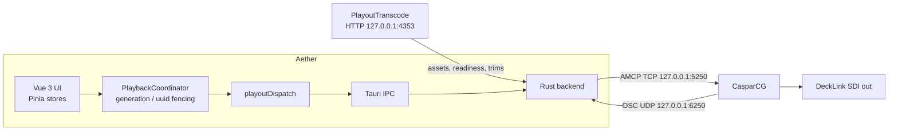

# Aether — PlayOut (PlayOutVue)

[](https://github.com/Soranokuni/PlayOutVue/actions/workflows/ci.yml)
[](LICENSE)
[](https://tauri.app/)
[](https://vuejs.org/)
[](https://www.rust-lang.org/)
[](https://casparcg.com/)

**Aether** is a Windows broadcast master-control (MCR) playout controller. It drives a local
[CasparCG](https://casparcg.com/) server over AMCP, follows its OSC feed for frame-accurate timing,
and plays media prepared by the companion ingest service
**[PlayoutTranscode](https://github.com/Soranokuni/PlayoutTranscode)**.

- Multi-playlist rundown with automatic, gapless advance (hardware preload with `LOADBG … AUTO`).
- Frame-accurate, non-destructive trims and virtual sub-clips (rational frame rates, interlace-aware).
- Greek NCRTV (ΕΣΡ) compliance: per-item age rating, content warnings and product-placement (TP),
  applied automatically on every take through the advisory CG template.
- Live DeckLink input with a two-click armed cut, news crawl, station ID bug.
- Engine supervision: crash relaunch with crash-loop breaker, on-air state restore, PlayOut self-recovery.
- Optional **PlayOut fork** of CasparCG (engine-side queue, fallback slate and filler list).
- CG Studio for designing the advisory graphics, with an optional AI designer.

## Documentation

| Document | Audience |
|---|---|
| [Operator manual](docs/OPERATOR-MANUAL.md) | On-air operators: the screen, building a rundown, going on air, graphics, alarms |
| [Administrator manual](docs/ADMIN-MANUAL.md) | Engineers: install, CasparCG and PlayoutTranscode setup, settings, files, troubleshooting |
| [Playback operational contract](docs/PLAYBACK-OPERATIONAL-CONTRACT.md) | Developers: identity, fencing and the playback state machine |
| [Operator UI contract](docs/OPERATOR-UI-CONTRACT.md) | Developers: UI safety rules and boundaries |
| [Reliability verification](docs/PLAYOUT-RELIABILITY-VERIFICATION.md) | Engineers: post-change test on a non-production channel |

## Architecture



- **Take / advance.** UI → `PlaybackCoordinator` (`src/lib/playbackCoordinator.ts`) → `playoutDispatch.ts` →
  Tauri → `amcp.rs`. The next clip is preloaded with `LOADBG 1-10 … SEEK LENGTH AUTO`; CasparCG cuts at EOF.
- **Advance authority (stock engine).** `caspar.rs` decides from OSC when a clip has ended and emits
  `caspar://advance`; the frontend accepts it only for the uuid it expects.
- **Fork engine.** When the engine answers `QUEUE 1-10 INFO` with `201`, it owns the queue and reports
  `onair <tag>`; Aether refills a tagged queue with `EXPECT` and attaches graphics as `ONAIR` actions.

### Channel 1 layer map (`src-tauri/src/caspar_layers.rs`)

| Layer | Use |
|---|---|
| 10 | Program video |
| 20 | Live input (DeckLink) |
| 30 | Station logo |
| 31 | Age rating (legacy, cleared on each apply) |
| 32 | Advisory CG — logo, rating, warnings, TP in one template |
| 33 | News crawl CG |
| 34 | TP badge (legacy, cleared on each apply) |
| 35 | Reserved for station ID sting |

`MIXER` is never sent to the CG layers 32 and 33.

## Repository layout

```text
src/                 Vue 3 frontend
  components/        Panels (RundownList, MediaLibrary, TrimPanel, SettingsModal, …) and ui/ primitives
  composables/       Keyboard routing, playlist files, panel state
  lib/               Pure logic: coordinator, dispatch, timecode, compliance, status resolution
  services/          caspar.ts (playout service), commandRegistry, fallback monitor
  stores/            rundown, mediaLibrary, settings, ingestorStatus, mediaRoot, lookAhead
src-tauri/src/       Rust backend
  amcp.rs            AMCP client (allow-listed verbs)
  caspar.rs          OSC listener, advance authority, path aliases
  caspar_process.rs  Engine supervision, monitor mode, crash breaker
  caspar_fork.rs     Fork detection, events, as-run
  ingestor_api.rs    PlayoutTranscode client (v2 with v1 fallback)
  media_server.rs    Loopback preview streaming (per-launch token)
  studio_server.rs   CG Studio bridge and AI designer
  recovery.rs        Checkpoints, watchdog, relaunch
templates-src/       Advisory / crawl CG source (built into public/ and src/assets/)
scripts/             Build helpers (advisory template, vcredist, ffmpeg, audit gate)
docs/                Manuals and contracts
```

## Building from source

### Prerequisites

- Windows 10/11 x64 with Microsoft C++ Build Tools (Visual Studio 2022, x64)
- Node.js `^22.22.2 || >=24.15.0` (enforced by `.npmrc` `engine-strict`)
- Rust via `rustup`; `rust-toolchain.toml` pins **1.99.1** (minimum supported 1.95)
- CasparCG 2.3+ on the same machine, and PlayoutTranscode for managed media

### Commands

```powershell
npm ci                       # install exact lockfile versions; registers lefthook hooks
npm run tauri dev            # desktop app with hot reload
npm run dev                  # frontend only, in a browser (Vite on :5173)
npm test                     # Vitest
npm run lint                 # ESLint (0 errors required)
npm run type-check           # vue-tsc
cargo test   --manifest-path src-tauri/Cargo.toml
cargo clippy --manifest-path src-tauri/Cargo.toml --all-targets -- -D warnings
npm run tauri build          # NSIS installer
```

The installer lands in `src-tauri/target/x86_64-pc-windows-msvc/release/bundle/nsis/`. The build downloads
and signature-checks the VC++ redistributable (`scripts/download-vcredist.ps1`). ffmpeg/ffprobe are **not**
bundled; run `scripts/download-ffmpeg.ps1` or see the [administrator manual](docs/ADMIN-MANUAL.md#ffmpeg-and-ffprobe).
Archive the matching `.pdb` from `…/release/` with every release so crash reports can be symbolised.

### Contributing

- Commits follow Conventional Commits (`type(scope): subject`); lefthook runs ESLint, type-check and
  `cargo check` before each commit.
- CI (`.github/workflows/ci.yml`) runs lint, type-check, tests, the frontend build, clippy, cargo tests and a
  dependency audit on every push and pull request. Renovate proposes dependency updates weekly.
- The advisory template in `public/templates/playout/` and `src/assets/templates/playout/` is build output of
  `templates-src/advisory`; edit the source and run `npm run build:cg`.

## Author and license

**Alex Fountas** ([@Soranokuni](https://github.com/Soranokuni)) ·
[fountasalexandros@gmail.com](mailto:fountasalexandros@gmail.com) · [afountas@cretetv.gr](mailto:afountas@cretetv.gr)

Copyright © 2026 Alex Fountas. Licensed under the [MIT License](LICENSE).
